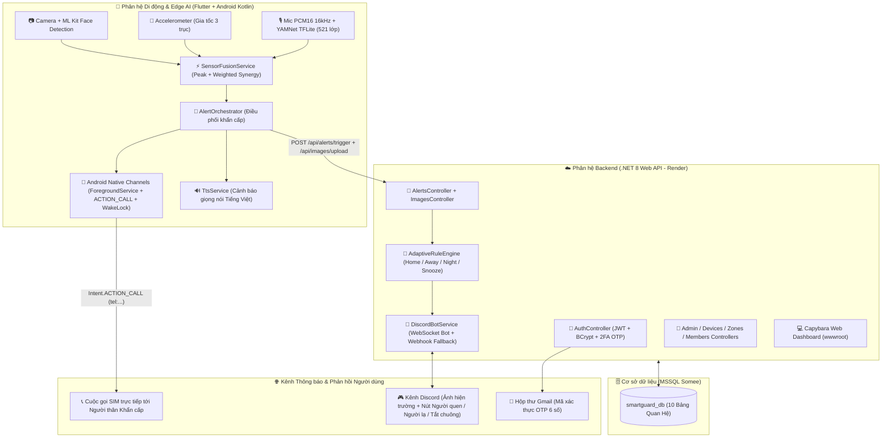

# 🛡️ SmartGuard Unified — Capybara Security Edition

> **Hệ thống giám sát an ninh camera thông minh đa nền tảng tích hợp Trí tuệ nhân tạo tại biên (Edge AI YAMNet & ML Kit Face Detection), Hợp nhất cảm biến (Sensor Fusion), Tự động gọi điện khẩn cấp qua SIM cho người thân, Cảnh báo tương tác hai chiều qua Discord và Bảo mật thích ứng theo ngữ cảnh (Smart Adaptive Security).**

[](https://dotnet.microsoft.com/)
[](https://flutter.dev/)
[](https://developer.android.com/)
[](https://www.microsoft.com/sql-server)
[](https://discord.com/)

---

## 📌 Mục lục
- [1. Giới thiệu tổng quan](#1-giới-thiệu-tổng-quan)
- [2. Kiến trúc tổng thể hệ thống](#2-kiến-trúc-tổng-thể-hệ-thống)
- [3. Toàn bộ chức năng hiện có của hệ thống (Chi tiết từng phân hệ)](#3-toàn-bộ-chức-năng-hiện-có-của-hệ-thống-chi-tiết-từng-phân-hệ)
  - [3.1. Danh bạ Người thân Khẩn cấp & Tự động gọi điện qua SIM thật](#31-danh-bạ-người-thân-khẩn-cấp--tự-động-gọi-điện-qua-sim-thật)
  - [3.2. Hợp nhất Đa Cảm biến (Sensor Fusion Engine) & Điều phối Báo động (AlertOrchestrator)](#32-hợp-nhất-đa-cảm-biến-sensor-fusion-engine--điều-phối-báo-động-alertorchestrator)
  - [3.3. Trí tuệ nhân tạo Âm thanh thời gian thực (YAMNet TFLite Audio AI)](#33-trí-tuệ-nhân-tạo-âm-thanh-thời-gian-thực-yamnet-tflite-audio-ai)
  - [3.4. Giám sát Camera Trực tiếp, Nhận diện Khuôn mặt ML Kit & Lọc Người quen](#34-giám-sát-camera-trực-tiếp-nhận-diện-khuôn-mặt-ml-kit--lọc-người-quen)
  - [3.5. Dịch vụ Chạy ngầm Bền bỉ (Android Foreground Service, WakeLock, BootReceiver & Doze Exemption)](#35-dịch-vụ-chạy-ngầm-bền-bỉ-android-foreground-service-wakelock-bootreceiver--doze-exemption)
  - [3.6. Bảo mật Thích ứng theo Ngữ cảnh (Smart Adaptive Security Engine)](#36-bảo-mật-thích-ứng-theo-ngữ-cảnh-smart-adaptive-security-engine)
  - [3.7. Cảnh báo Tương tác Hai chiều qua Discord Bot & Webhook](#37-cảnh-báo-tương-tác-hai-chiều-qua-discord-bot--webhook)
  - [3.8. Xác thực Đa tầng (2FA Email OTP, Sinh trắc học Vân tay/FaceID, JWT & Rate Limiting)](#38-xác-thực-đa-tầng-2fa-email-otp-sinh-trắc-học-vân-tayfaceid-jwt--rate-limiting)
  - [3.9. Quản lý Thiết bị IoT, Ghép nối Mã Thiết bị (DeviceCode) & Phân vùng (Zones)](#39-quản-lý-thiết-bị-iot-ghép-nối-mã-thiết-bị-devicecode--phân-vùng-zones)
  - [3.10. Chia sẻ Quyền Truy cập Gia đình (Member Access) & Phân quyền Quản trị (Admin Panel)](#310-chia-sẻ-quyền-truy-cập-gia-đình-member-access--phân-quyền-quản-trị-admin-panel)
  - [3.11. Web Dashboard Capybara Security tích hợp sẵn trên Backend](#311-web-dashboard-capybara-security-tích-hợp-sẵn-trên-backend)
- [4. Bản đồ Mã nguồn Chi tiết (File-by-File Inventory)](#4-bản-đồ-mã-nguồn-chi-tiết-file-by-file-inventory)
- [5. Cơ sở dữ liệu (Database Schema - 10 Bảng)](#5-cơ-sở-dữ-liệu-database-schema---10-bảng)
- [6. Danh mục toàn bộ API Endpoints](#6-danh-mục-toàn-bộ-api-endpoints)
- [7. Hướng dẫn Cài đặt & Triển khai](#7-hướng-dẫn-cài-đặt--triển-khai)

---

## 1. Giới thiệu tổng quan

**SmartGuard Unified (Capybara Security Edition)** là hệ sinh thái an ninh thông minh hợp nhất giữa **Thiết bị di động (Flutter + Android Native Kotlin)**, **Web Dashboard (SPA HTML5/JS/CSS)** và **Máy chủ Đám mây (ASP.NET Core 8 + SQL Server)**.

Hệ thống tận dụng toàn bộ phần cứng của điện thoại thông minh (Camera trước/sau, Cảm biến gia tốc 3 trục, Microphone thu âm PCM16, Mô-đun gọi điện SIM, Động cơ rung và Loa phát giọng nói Tiếng Việt TTS) kết hợp cùng trí tuệ nhân tạo tại biên (**Google ML Kit Face Detection** + **TensorFlow Lite YAMNet 521 lớp âm thanh**) để phát hiện sớm mọi nguy cơ đột nhập, cạy cửa, đập kính và tự động thực hiện chuỗi phản ứng khẩn cấp trong tích tắc.

---

## 2. Kiến trúc tổng thể hệ thống



---

## 3. Toàn bộ chức năng hiện có của hệ thống (Chi tiết từng phân hệ)

### 3.1. Danh bạ Người thân Khẩn cấp & Tự động gọi điện qua SIM thật
Được triển khai tại [`emergency_service.dart`](frontend/smartguard_mobile/lib/services/emergency_service.dart), [`members_screen.dart`](frontend/smartguard_mobile/lib/screens/members/members_screen.dart), [`foreground_service_controller.dart`](frontend/smartguard_mobile/lib/services/foreground_service_controller.dart) và [`MainActivity.kt`](frontend/smartguard_mobile/android/app/src/main/kotlin/com/smartguard/smartguard_mobile/MainActivity.kt):
- **Quản lý danh bạ khẩn cấp (`EmergencyContactModel`)**:
  - Cho phép thêm, xem, xóa người thân với các thông tin: **Họ và tên**, **Số điện thoại khẩn cấp**, **Mối quan hệ** (*Chủ nhà, Vợ/Chồng, Bố/Mẹ, Con cái, Anh/Chị/Em, Hàng xóm thân thiết, Bảo vệ tòa nhà*).
  - Tùy chỉnh độc lập 2 công tắc trên từng liên hệ:
    - `isCallAlert`: Tự động quay số gọi điện khi có sự cố.
    - `isSmsAlert`: Tự động gửi tin nhắn SMS vị trí & cảnh báo.
  - Khởi tạo sẵn 3 liên hệ mẫu (*Quỳnh Hương - Chủ nhà*, *Minh Trí - Bố*, *Bảo Anh - Vợ*) lưu trữ bền vững trong `SharedPreferences` (`smartguard_emergency_contacts`).
- **Gọi điện trực tiếp qua SIM phần cứng (`Intent.ACTION_CALL`)**:
  - Khác với các ứng dụng thông thường chỉ mở màn hình拨 số (`ACTION_DIAL`), SmartGuard tích hợp cầu nối Native Kotlin `MethodChannel('com.smartguard/phone')` trong [`MainActivity.kt`](frontend/smartguard_mobile/android/app/src/main/kotlin/com/smartguard/smartguard_mobile/MainActivity.kt#L89-L108) và hàm `makePhoneCall(phoneNumber)`.
  - Khi phát hiện đột nhập, `AlertOrchestrator._callEmergencyContacts()` tự động lấy người thân đầu tiên có bật `isCallAlert`, kiểm tra quyền `Manifest.permission.CALL_PHONE` và **thực hiện cuộc gọi SIM trực tiếp ngay lập tức** mà không cần thao tác chạm tay của người dùng.
  - Trên giao diện **Thành viên (`MembersScreen`)**, mỗi thẻ người thân đều có nút **Thử nghiệm gọi tự động (`Icons.phone_forwarded`)** -> hiển thị tóm tắt điều phối và nút **"Gọi ngay qua SIM"** để kiểm tra đường truyền viễn thông thực tế.

### 3.2. Hợp nhất Đa Cảm biến (Sensor Fusion Engine) & Điều phối Báo động (AlertOrchestrator)
Được triển khai tại [`sensor_fusion_service.dart`](frontend/smartguard_mobile/lib/services/sensor_fusion_service.dart) và [`motion_detection_screen.dart`](frontend/smartguard_mobile/lib/screens/motion/motion_detection_screen.dart):
- **Công thức hợp nhất Trọng số & Đỉnh (Peak-Weighted Synergy Formula)**:
  - Kết hợp 3 nguồn tín hiệu thời gian thực:
    - **Chuyển động/Rung lắc (`Motion` - Trọng số 40%)**: Độ lệch gia tốc $\Delta a = |\|a\| - a_{prev}|$ chuẩn hóa theo ngưỡng `motionThreshold` (mặc định $3.5\text{ m/s}^2$).
    - **Âm thanh AI (`Sound` - Trọng số 40%)**: Điểm nguy cơ có trọng số từ mô hình YAMNet TFLite (`0.0 – 1.0`).
    - **Thị giác máy tính (`Vision` - Trọng số 20%)**: Điểm phát hiện khuôn mặt từ camera.
  - Công thức tính điểm hợp nhất:
    $$\text{weighted} = 0.40 \times S_{\text{motion}} + 0.40 \times S_{\text{sound}} + 0.20 \times S_{\text{vision}}$$
    $$\text{peak} = \max(S_{\text{motion}}, S_{\text{sound}}, S_{\text{vision}})$$
    $$\text{fusedScore} = \text{clamp}\big(\max(\text{weighted},\; 0.85 \times \text{peak} + 0.25 \times \text{weighted}),\; 0.0,\; 1.0\big)$$
  - Giúp hệ thống **không bỏ sót sự cố đơn lẻ cực mạnh** (ví dụ: tiếng kính vỡ 90% khi điện thoại đặt cố định trên bàn không rung lắc) đồng thời **chống báo động giả** trước các nhiễu nhỏ lẻ.
- **Điều phối Báo động Toàn diện (`AlertOrchestrator.triggerFullAlert`)**:
  - Có cơ chế chống lặp (`cooldown = 30 giây`) và thực thi tuần tự 5 bước tự động:
    1. **Rung cảnh báo (`Vibration`)** theo nhịp khẩn cấp `[0, 400, 200, 400, 200, 800]`.
    2. **Phát giọng nói Tiếng Việt (`TtsService`)**: *"Cảnh báo! Phát hiện xâm nhập tại [Tên thiết bị]. Hệ thống đang thông báo người thân."*
    3. **Đẩy thông báo độ ưu tiên tối đa (`PRIORITY_MAX`)** lên thanh trạng thái Android qua `ForegroundServiceController.notifyAlarm`.
    4. **Gửi API `POST /api/alerts/trigger`** lên Cloud Server để đánh giá Adaptive Rule và bắn cảnh báo sang Discord.
    5. **Quay số gọi điện khẩn cấp qua SIM** tới người thân đầu tiên trong danh bạ.

### 3.3. Trí tuệ nhân tạo Âm thanh thời gian thực (YAMNet TFLite Audio AI)
Được triển khai tại [`sound_classifier_service.dart`](frontend/smartguard_mobile/lib/services/sound_classifier_service.dart):
- Thu âm trực tiếp luồng **PCM 16-bit, tần số lấy mẫu 16.000 Hz, Mono** qua thư viện `record`.
- Chuẩn hóa mẫu âm thanh sang `Float32 [-1.0, 1.0]` theo từng cửa sổ 15.600 mẫu ($\approx 0.975$ giây).
- **Cổng im lặng (Silence Gate RMS)**: Tự động bỏ qua suy luận AI khi phòng yên tĩnh ($\text{RMS} < 0.008$) để tiết kiệm pin và không làm nóng máy.
- **Chạy trên luồng cô lập (`IsolateInterpreter`)**: Phân loại 521 lớp âm thanh của mô hình `yamnet.tflite` mà không làm giật/đơ giao diện người dùng.
- **Bảng trọng số nguy cơ thông minh (`_weightForLabel`)**:
  - **Nhóm nguy hiểm cực cao (Trọng số `1.0`)**: Kính vỡ (*Glass, Shatter, Smash, Crash*), Tiếng la hét/Kêu cứu (*Scream, Groan,Grunt*), Tiếng nổ/Súng (*Gunshot, Explosion*), Còi báo động (*Siren, Smoke detector, Fire alarm*).
  - **Nhóm đột nhập/Cạy phá (Trọng số `0.75`)**: Tiếng đập cửa, cạy tủ, bước chân chạy, cưa, khoan, búa (*Knock, Slam, Thump,Door, Footsteps, Hammer, Saw, Drill*).
  - **Nhóm cảnh giác (Trọng số `0.45`)**: Tiếng chó sủa, tiếng khóc (*Bark,Growl, Crying*).
  - **Nhóm sinh hoạt/Nhiễu nền (Trọng số `0.0`)**: Tiếng nói chuyện bình thường, âm nhạc, tiếng mưa, gió, tivi (*Speech, Music, Rain, Wind*) -> **không bao giờ gây báo động giả**.

### 3.4. Giám sát Camera Trực tiếp, Nhận diện Khuôn mặt ML Kit & Lọc Người quen
Được triển khai tại [`camera_guard_screen.dart`](frontend/smartguard_mobile/lib/screens/camera/camera_guard_screen.dart) và [`admin_screen.dart`](frontend/smartguard_mobile/lib/screens/admin/admin_screen.dart):
- **Xem luồng video trực tiếp (`CameraPreview`)**: Hỗ trợ chuyển đổi camera trước/sau, chụp ảnh nhanh (`_takeSnapshot`), bật/tắt âm thanh, đàm thoại hai chiều (`Intercom`) và chế độ toàn màn hình.
- **Nhận diện khuôn mặt thời gian thực (`google_mlkit_face_detection`)**: Phân tích từng khung hình (`NV21`) từ luồng camera.
- **Tự động phân biệt Người quen & Người lạ (`KnownPersonModel`)**:
  - Quản trị viên/Chủ nhà có thể đăng ký danh sách người quen trong mục Quản trị (`sg_known_persons`).
  - Khi phát hiện khuôn mặt trong khung hình:
    - Nếu khớp chế độ nhận diện **Người quen**: Hệ thống tự động đọc lời chào tiếng Việt (*"Đã nhận diện khuôn mặt người quen. Hệ thống đã tắt còi báo động và tạm dừng cảnh báo"*), đổi trạng thái sang xanh lá mà không phát báo động.
    - Nếu là **Người lạ** hoặc **Rung lắc thiết bị ($\Delta a > 3.8\text{ m/s}^2$)**: Tự động chụp ảnh hiện trường, tải lên server (`POST /api/images/upload`), kích hoạt `POST /api/alerts/trigger` và gọi điện khẩn cấp qua `AlertOrchestrator`.
- **Đồng bộ trạng thái điều khiển từ xa (2-Second Polling)**:
  - Khi đang báo động, ứng dụng liên tục kiểm tra `GET /api/alerts/device/{deviceId}/status` mỗi 2 giây. Nếu chủ nhà bấm nút **"✅ Người quen"** hoặc **"🔕 Tắt chuông"** trên Discord hoặc Web Dashboard, điện thoại sẽ **tự động ngừng hú còi ngay lập tức** và chuyển sang chế độ nghỉ 3 phút (`Snooze`).

### 3.5. Dịch vụ Chạy ngầm Bền bỉ (Android Foreground Service, WakeLock, BootReceiver & Doze Exemption)
Được triển khai tại [`SmartGuardForegroundService.kt`](frontend/smartguard_mobile/android/app/src/main/kotlin/com/smartguard/smartguard_mobile/SmartGuardForegroundService.kt), [`SmartGuardBootReceiver.kt`](frontend/smartguard_mobile/android/app/src/main/kotlin/com/smartguard/smartguard_mobile/SmartGuardBootReceiver.kt) và [`battery_exemption_prompt.dart`](frontend/smartguard_mobile/lib/widgets/battery_exemption_prompt.dart):
- **`SmartGuardForegroundService` (`START_STICKY`)**:
  - Giữ kết nối canh gác liên tục trên thanh thông báo Android ngay cả khi khóa màn hình hoặc thoát ứng dụng.
  - Giữ **`PARTIAL_WAKE_LOCK`** (tối đa 8 giờ/phiên) để ngăn CPU ngủ đông trong lúc canh gác.
  - Tự động đặt lịch khởi động lại sau 2 giây qua `AlarmManager` trong `onTaskRemoved()` nếu người dùng vô tình vuốt xóa ứng dụng khỏi danh sách đa nhiệm (Recent Apps).
- **`SmartGuardBootReceiver`**: Lắng nghe sự kiện `BOOT_COMPLETED` và `QUICKBOOT_POWERON` để tự động bật lại dịch vụ bảo vệ ngay khi điện thoại khởi động lại.
- **Miễn trừ Tối ưu hóa Pin (`BatteryStatusCard`)**: Kiểm tra và mở hộp thoại hệ thống `ACTION_REQUEST_IGNORE_BATTERY_OPTIMIZATIONS` để Android Doze Mode không thể đóng băng ứng dụng.

### 3.6. Bảo mật Thích ứng theo Ngữ cảnh (Smart Adaptive Security Engine)
Được triển khai tại [`AdaptiveRuleEngine.cs`](backend/SmartGuard.API/Services/Adaptive/AdaptiveRuleEngine.cs), [`AdaptiveSecurityController.cs`](backend/SmartGuard.API/Controllers/AdaptiveSecurityController.cs) và [`adaptive_security_screen.dart`](frontend/smartguard_mobile/lib/screens/adaptive/adaptive_security_screen.dart):
- Tự động khởi tạo và quản lý 3 Hồ sơ Bảo mật Thích ứng cho mỗi người dùng:
  1. **Chế độ Ở nhà (`Home`)**: Tự động tắt giám sát (`EnableMonitoring = false`) tại các phân vùng sinh hoạt (Phòng khách, Phòng bếp, Phòng ngủ) để tránh làm phiền gia đình, chỉ bật canh gác ở Cổng chính/Sân ngoài với độ nhạy `x0.8`.
  2. **Chế độ Rời nhà (`Away`)**: Bật giám sát toàn bộ các phân vùng với độ nhạy `x1.2`, bật còi báo động và thông báo Discord khẩn cấp (`BehaviorOnDisconnect = FailSecure`).
  3. **Chế độ Ban đêm (`Night`)**: Hoạt động trong khung giờ `22:00 – 06:00` với hệ số độ nhạy tối đa `x1.5`, kích hoạt còi hú tại chỗ ngay lập tức.
- **Cơ chế Tạm dừng Cảnh báo (`Snooze Override`)**: Cho phép tạm dừng toàn bộ báo động trong $N$ phút (5, 15, 30, 60 phút) hoặc hủy tạm dừng bất cứ lúc nào.
- **Diễn giải Quyết định AI (`Explainable Alert`)**: Mỗi sự kiện cảnh báo đều lưu lại lý do rõ ràng trong trường `AdaptiveReason` (ví dụ: *"Kích hoạt bởi Chế độ [Ở nhà] tại khu vực [Cổng chính] (Độ nhạy x1.0)"*).

### 3.7. Cảnh báo Tương tác Hai chiều qua Discord Bot & Webhook
Được triển khai tại [`DiscordBotService.cs`](backend/SmartGuard.API/Services/Discord/DiscordBotService.cs) và [`AlertsController.cs`](backend/SmartGuard.API/Controllers/AlertsController.cs):
- **Chế độ Kép (Dual-Mode Delivery)**:
  - **Chế độ 1 — Discord Socket Bot**: Gửi tin nhắn nhúng (Rich Embed) kèm file ảnh hiện trường và **3 nút bấm tương tác (`ButtonComponent`)**:
    - `✅ Người quen`: Đánh dấu `KnownPerson`, tắt còi báo động trên điện thoại và tự động bật `Snooze` 3 phút.
    - `🚨 Người lạ`: Xác nhận xâm nhập nguy hiểm (`ConfirmedStranger`), duy trì báo động khẩn cấp.
    - `🔕 Tắt chuông`: Đánh dấu `Muted`, tắt chuông từ xa và tạm dừng cảnh báo 3 phút.
  - **Chế độ 2 — Discord Webhook Fallback**: Khi chưa cấu hình `BotToken` hoặc mất kết nối Gateway, hệ thống tự động chuyển sang gửi qua `WebhookUrl` gồm cả **Rich Embed chứa 3 đường link thao tác nhanh (`/api/alerts/{id}/quick-action?action=known|stranger|mute`)** và **tải kèm file ảnh bằng chứng (`multipart/form-data`)**.

### 3.8. Xác thực Đa tầng (2FA Email OTP, Sinh trắc học Vân tay/FaceID, JWT & Rate Limiting)
Được triển khai tại [`AuthController.cs`](backend/SmartGuard.API/Controllers/AuthController.cs), [`EmailService.cs`](backend/SmartGuard.API/Services/Email/EmailService.cs), [`TokenService.cs`](backend/SmartGuard.API/Services/Security/TokenService.cs) và [`auth_service.dart`](frontend/smartguard_mobile/lib/services/auth_service.dart):
- **Đăng nhập 2 bước (2FA OTP)**:
  - Bước 1 (`POST /api/Auth/login`): Kiểm tra thông tin đăng nhập (chấp nhận cả `Email` hoặc `Username`), kiểm tra khóa tài khoản (`IsLocked`), tạo mã OTP 6 chữ số ngẫu nhiên an toàn (`RandomNumberGenerator`), băm bằng BCrypt lưu vào bảng `OtpChallenges` (hiệu lực 5 phút, tối đa 5 lần thử sai).
  - Bước 2 (`POST /api/Auth/verify-otp`): Gửi mã OTP qua Gmail SMTP (`MailKit`). Nếu là tài khoản nội bộ (`.local`) hoặc mạng chặn SMTP, hệ thống tự động cung cấp `devOtp` để không làm gián đoạn trải nghiệm. Khi xác thực đúng, cấp phát **JWT Bearer Token** (hiệu lực 24 giờ).
- **Mở khóa Sinh trắc học (`local_auth`)**: Hỗ trợ đăng nhập nhanh trên ứng dụng di động bằng Vân tay hoặc FaceID đã lưu phiên.
- **Chống tấn công Brute-Force (`RateLimiter`)**: Giới hạn tối đa 15 yêu cầu/phút trên mỗi địa chỉ IP cho toàn bộ cụm API xác thực (`auth-rate-limit`).

### 3.9. Quản lý Thiết bị IoT, Ghép nối Mã Thiết bị (DeviceCode) & Phân vùng (Zones)
Được triển khai tại [`DevicesController.cs`](backend/SmartGuard.API/Controllers/DevicesController.cs), [`ZonesController.cs`](backend/SmartGuard.API/Controllers/ZonesController.cs) và [`zones_screen.dart`](frontend/smartguard_mobile/lib/screens/zones/zones_screen.dart):
- **Quản lý Phân vùng (`Zones`)**: Tạo, sửa, xóa các khu vực an ninh (*Phòng khách, Cổng chính, Sân trước, Ban công...*) và thống kê số lượng thiết bị trong từng vùng.
- **Quản lý Thiết bị (`Devices`)**:
  - Mỗi thiết bị khi tạo sẽ được sinh tự động một **Mã ghép nối duy nhất (`DeviceCode`)** gồm 8 ký tự in hoa (ví dụ: `CAM-GATE-01`).
  - Hỗ trợ ghép nối nhanh thiết bị bằng mã (`POST /api/Devices/pair`), bật/tắt trạng thái cảnh giác (`PATCH /api/Devices/{id}/toggle-arm`), và tùy chỉnh ngưỡng âm thanh (`NoiseThreshold` dB) cũng như ngưỡng rung (`MotionThreshold` $\text{m/s}^2$).

### 3.10. Chia sẻ Quyền Truy cập Gia đình (Member Access) & Phân quyền Quản trị (Admin Panel)
Được triển khai tại [`MembersController.cs`](backend/SmartGuard.API/Controllers/MembersController.cs), [`AdminController.cs`](backend/SmartGuard.API/Controllers/AdminController.cs) và [`admin_screen.dart`](frontend/smartguard_mobile/lib/screens/admin/admin_screen.dart):
- **Chia sẻ quyền cho Thành viên (`MemberAccesses`)**: Chủ nhà (`Owner`) có thể nhập Email của người thân để cấp quyền xem toàn bộ camera (`DeviceId = null`) hoặc chỉ một camera cụ thể, kèm tùy chọn cho phép tắt chuông/xác nhận báo động (`CanAcknowledge`).
- **Trung tâm Quản trị Hệ thống (`AdminScreen` - 4 Tabs)**:
  - **Thống kê tổng quan**: Tổng số người dùng, tổng thiết bị, số thiết bị đang bật canh gác, số cảnh báo trong ngày, thông tin tài nguyên máy chủ (RAM, OS, .NET Runtime, Uptime).
  - **Quản lý Người dùng**: Tìm kiếm, thêm mới tài khoản (`Admin`/`Owner`/`Member`), cập nhật thông tin, khóa/mở khóa (`IsLocked`) hoặc xóa tài khoản an toàn.
  - **Quản lý Kho ảnh Bằng chứng (`ImagesController`)**: Xem lưới ảnh chụp hiện trường (`/evidence/...`) và xóa ảnh cũ để giải phóng dung lượng.
  - **Quản lý Danh sách Người quen (`KnownPersons`)**: Thêm/xóa người quen để Camera AI tự động nhận diện và bỏ qua báo động.

### 3.11. Web Dashboard Capybara Security tích hợp sẵn trên Backend
Được triển khai tại [`backend/SmartGuard.API/wwwroot/`](backend/SmartGuard.API/wwwroot/index.html):
- Giao diện Web SPA hiện đại phục vụ trực tiếp từ máy chủ ASP.NET Core 8 tại đường dẫn gốc `/`.
- Bao gồm đầy đủ các màn hình: **Tổng quan Dashboard**, **Giám sát Camera trực tiếp qua WebRTC/Webcam trình duyệt (`camera.js`)**, **Quản lý Thiết bị & Phân vùng**, **Nhật ký Báo động**, **Kho ảnh Bằng chứng**, **Cấu hình Adaptive Security** và **Đăng nhập / Đăng ký tài khoản + Xác thực OTP 2FA**.

---

## 4. Bản đồ Mã nguồn Chi tiết (File-by-File Inventory)

### A. Phân hệ Backend (`backend/SmartGuard.API`)
| Đường dẫn File | Vai trò & Chức năng chi tiết |
| :--- | :--- |
| [`Program.cs`](backend/SmartGuard.API/Program.cs) | Cấu hình DI, EF Core SQL Server (Retry & Timeout 15s), JWT Auth, Rate Limiter, Swagger, Auto-Migrate, Seed Admin và Endpoint `/api/status/db`. |
| [`Data/SmartGuardDbContext.cs`](backend/SmartGuard.API/Data/SmartGuardDbContext.cs) | Định nghĩa 9 `DbSet` nghiệp vụ, cấu hình Unique Index (`Email`, `Username`, `DeviceCode`) và quy tắc khóa ngoại. |
| [`Models/Entities.cs`](backend/SmartGuard.API/Models/Entities.cs) | Định nghĩa 9 thực thể CSDL: `User`, `OtpChallenge`, `Zone`, `GuardDevice`, `MemberAccess`, `AlertEvent`, `EvidenceImage`, `AdaptiveProfile`, `AdaptiveZoneRule`. |
| [`DTOs/AllDtos.cs`](backend/SmartGuard.API/DTOs/AllDtos.cs) | Toàn bộ các Record DTO cho Request/Response của hệ thống. |
| [`Controllers/AuthController.cs`](backend/SmartGuard.API/Controllers/AuthController.cs) | Đăng ký (`register`), Đăng nhập phát sinh OTP (`login`), Xác thực OTP cấp JWT (`verify-otp`), Lấy hồ sơ (`me`). |
| [`Controllers/DevicesController.cs`](backend/SmartGuard.API/Controllers/DevicesController.cs) | CRUD thiết bị, ghép nối bằng mã (`pair`), bật/tắt cảnh giác (`toggle-arm`), phân tách thiết bị sở hữu và thiết bị được chia sẻ. |
| [`Controllers/ZonesController.cs`](backend/SmartGuard.API/Controllers/ZonesController.cs) | CRUD phân vùng không gian an ninh (`Zones`). |
| [`Controllers/AlertsController.cs`](backend/SmartGuard.API/Controllers/AlertsController.cs) | Kích hoạt báo động (`trigger`), lịch sử (`history`), kiểm tra trạng thái (`device/{id}/status`), xử lý báo động từ App (`action`) và từ link Discord (`quick-action`). |
| [`Controllers/ImagesController.cs`](backend/SmartGuard.API/Controllers/ImagesController.cs) | Tải ảnh bằng chứng (`upload`), liệt kê danh sách ảnh (`list`) và xóa ảnh (`DELETE {id}`). |
| [`Controllers/MembersController.cs`](backend/SmartGuard.API/Controllers/MembersController.cs) | Chia sẻ quyền truy cập camera cho thành viên gia đình (`share`) và thu hồi quyền (`revoke`). |
| [`Controllers/AdaptiveSecurityController.cs`](backend/SmartGuard.API/Controllers/AdaptiveSecurityController.cs) | Lấy danh sách hồ sơ thích ứng (`profiles`), kích hoạt chế độ (`activate`), cập nhật quy tắc vùng, bật/hủy `snooze`. |
| [`Controllers/AdminController.cs`](backend/SmartGuard.API/Controllers/AdminController.cs) | Thống kê hệ thống (`stats`, `system`), quản lý toàn diện người dùng (`users`, khóa/mở khóa, phân quyền, xóa). |
| [`Services/Adaptive/AdaptiveRuleEngine.cs`](backend/SmartGuard.API/Services/Adaptive/AdaptiveRuleEngine.cs) | Bộ máy đánh giá kịch bản an ninh thích ứng (`Home`, `Away`, `Night`, `Snooze`) và sinh lời giải thích `AdaptiveReason`. |
| [`Services/Discord/DiscordBotService.cs`](backend/SmartGuard.API/Services/Discord/DiscordBotService.cs) | Dịch vụ chạy nền `IHostedService` kết nối Discord Bot WebSocket, xử lý sự kiện bấm nút và tự động fallback sang Discord Webhook. |
| [`Services/Email/EmailService.cs`](backend/SmartGuard.API/Services/Email/EmailService.cs) | Gửi email mã xác thực OTP 2FA qua Gmail SMTP (`MailKit`) kèm cơ chế dự phòng Local/Dev OTP. |
| [`Services/Security/TokenService.cs`](backend/SmartGuard.API/Services/Security/TokenService.cs) | Băm mật khẩu/OTP bằng BCrypt (WorkFactor 11) và ký/xác thực JWT Bearer Token. |

### B. Phân hệ Mobile (`frontend/smartguard_mobile`)
| Đường dẫn File | Vai trò & Chức năng chi tiết |
| :--- | :--- |
| [`lib/main.dart`](frontend/smartguard_mobile/lib/main.dart) | Điểm khởi đầu ứng dụng Flutter, kiểm tra phiên đăng nhập tự động. |
| [`lib/core/app_config.dart`](frontend/smartguard_mobile/lib/core/app_config.dart) | Quản lý địa chỉ máy chủ API (`baseUrl`), lưu trữ cấu hình linh hoạt (Render Cloud, LAN, Emulator, Localhost). |
| [`lib/core/api_client.dart`](frontend/smartguard_mobile/lib/core/api_client.dart) | HTTP Client tự động đính kèm JWT Token, tải file ảnh Multipart và kiểm tra chẩn đoán kết nối máy chủ. |
| [`lib/services/emergency_service.dart`](frontend/smartguard_mobile/lib/services/emergency_service.dart) | Quản lý danh bạ người thân khẩn cấp và điều phối danh sách gọi điện/SMS khi có đột nhập. |
| [`lib/services/sensor_fusion_service.dart`](frontend/smartguard_mobile/lib/services/sensor_fusion_service.dart) | Hợp nhất gia tốc + âm thanh AI + thị giác (`SensorFusionService`) và điều phối chuỗi phản ứng (`AlertOrchestrator`). |
| [`lib/services/sound_classifier_service.dart`](frontend/smartguard_mobile/lib/services/sound_classifier_service.dart) | Phân tích âm thanh thời gian thực bằng mô hình AI `yamnet.tflite` trên `IsolateInterpreter`. |
| [`lib/services/foreground_service_controller.dart`](frontend/smartguard_mobile/lib/services/foreground_service_controller.dart) | Cầu nối Dart <-> Kotlin gọi Foreground Service, gọi điện khẩn cấp qua SIM và xin miễn trừ tối ưu pin. |
| [`lib/services/tts_service.dart`](frontend/smartguard_mobile/lib/services/tts_service.dart) | Phát giọng nói cảnh báo Tiếng Việt (`vi-VN`) khi phát hiện người lạ, rung lắc hoặc chào người quen. |
| [`lib/screens/camera/camera_guard_screen.dart`](frontend/smartguard_mobile/lib/screens/camera/camera_guard_screen.dart) | Màn hình canh gác Camera AI trực tiếp, nhận diện khuôn mặt ML Kit, tự động chụp bằng chứng và đồng bộ tắt chuông từ Discord. |
| [`lib/screens/motion/motion_detection_screen.dart`](frontend/smartguard_mobile/lib/screens/motion/motion_detection_screen.dart) | Màn hình giám sát chuyển động & âm thanh AI, biểu đồ sóng âm trực tiếp và tùy chỉnh độ nhạy cảm biến. |
| [`lib/screens/members/members_screen.dart`](frontend/smartguard_mobile/lib/screens/members/members_screen.dart) | Quản lý danh bạ người thân khẩn cấp (thêm, xóa, gọi thử qua SIM) và chia sẻ quyền truy cập tài khoản qua Email. |
| [`lib/screens/adaptive/adaptive_security_screen.dart`](frontend/smartguard_mobile/lib/screens/adaptive/adaptive_security_screen.dart) | Chuyển đổi và tinh chỉnh quy tắc cho 3 chế độ *Ở nhà*, *Rời nhà*, *Ban đêm* và hẹn giờ *Tạm dừng (Snooze)*. |
| [`lib/screens/admin/admin_screen.dart`](frontend/smartguard_mobile/lib/screens/admin/admin_screen.dart) | Bảng điều khiển dành cho Admin: Thống kê, Quản lý User, Kho ảnh bằng chứng và Đăng ký Người quen. |
| [`android/.../MainActivity.kt`](frontend/smartguard_mobile/android/app/src/main/kotlin/com/smartguard/smartguard_mobile/MainActivity.kt) | Xử lý 3 MethodChannel Native: `com.smartguard/foreground`, `com.smartguard/phone` (`ACTION_CALL`) và `com.smartguard/permissions`. |
| [`android/.../SmartGuardForegroundService.kt`](frontend/smartguard_mobile/android/app/src/main/kotlin/com/smartguard/smartguard_mobile/SmartGuardForegroundService.kt) | Dịch vụ Android Foreground giữ `WakeLock` và tự động hồi sinh tiến trình khi bị đóng. |

---

## 5. Cơ sở dữ liệu (Database Schema - 10 Bảng)

Toàn bộ cấu trúc CSDL và dữ liệu mẫu được định nghĩa tại [`database/smartguard_db_script.sql`](database/smartguard_db_script.sql):

| STT | Tên Bảng | Khóa Chính / Chỉ Mục | Mô tả Chức năng |
| :---: | :--- | :--- | :--- |
| **0** | `__EFMigrationsHistory` | `PK_MigrationId` | Quản lý lịch sử phiên bản Migration của Entity Framework Core. |
| **1** | `Users` | `PK_Id`, `UX_Email`, `UX_Username` | Lưu tài khoản người dùng, mật khẩu băm BCrypt, vai trò (`Admin`, `Owner`, `Member`) và trạng thái khóa (`IsLocked`). |
| **2** | `OtpChallenges` | `PK_Id`, `IX_UserId` | Quản lý phiên xác thực 2FA OTP 6 số, số lần nhập sai (`Attempts <= 5`), thời hạn 5 phút (`ExpiresAt`). |
| **3** | `Zones` | `PK_Id`, `IX_OwnerId` | Lưu các phân vùng an ninh trong nhà (*Cổng chính, Phòng khách, Sân trước, Ban công*). |
| **4** | `Devices` | `PK_Id`, `UX_DeviceCode` | Lưu thiết bị camera/cảm biến, mã ghép nối `DeviceCode`, trạng thái `IsArmed`, ngưỡng ồn và ngưỡng rung. |
| **5** | `MemberAccesses` | `PK_Id`, `IX_MemberUserId` | Lưu quyền chia sẻ thiết bị từ Chủ nhà (`OwnerId`) sang Thành viên (`MemberUserId`). |
| **6** | `AlertEvents` | `PK_Id`, `IX_DeviceId` | Nhật ký sự kiện báo động (`TriggerReason`, `TriggerScore`, `Severity`, `Status`, `ImageUrl`, `AdaptiveReason`). |
| **7** | `EvidenceImages` | `PK_Id`, `IX_AlertEventId` | Lưu thông tin tệp ảnh chụp bằng chứng hiện trường liên kết với sự kiện báo động. |
| **8** | `AdaptiveProfiles` | `PK_Id`, `IX_UserId` | Lưu các chế độ bảo mật thích ứng (`Home`, `Away`, `Night`), khung giờ hoạt động và thời점 `SnoozeUntil`. |
| **9** | `AdaptiveZoneRules` | `PK_Id`, `IX_ProfileId` | Quy tắc chi tiết cho từng phân vùng trong mỗi chế độ (Bật/tắt giám sát, bật/tắt còi, gửi Discord, hệ số nhạy). |

---

## 6. Danh mục toàn bộ API Endpoints

| Nhóm | Phương thức & Đường dẫn | Quyền hạn | Chức năng |
| :--- | :--- | :---: | :--- |
| **System** | `GET /api/status` | Công khai | Kiểm tra trạng thái hoạt động của dịch vụ API. |
| **System** | `GET /api/status/db` | Công khai | Kiểm tra kết nối SQL Server trực tiếp, độ trễ (ms) và danh sách tài khoản hiện có. |
| **Auth** | `POST /api/Auth/register` | Công khai | Đăng ký tài khoản mới (`Owner` / `Member`). |
| **Auth** | `POST /api/Auth/login` | Công khai | Đăng nhập bước 1: Kiểm tra mật khẩu & gửi mã OTP 6 số qua Email (hoặc trả về `devOtp`). |
| **Auth** | `POST /api/Auth/verify-otp` | Công khai | Đăng nhập bước 2: Xác thực mã OTP và nhận JWT Bearer Token. |
| **Auth** | `GET /api/Auth/me` | `Authenticated` | Lấy thông tin hồ sơ người dùng hiện tại từ Token. |
| **Devices** | `GET /api/Devices` | `Authenticated` | Lấy danh sách thiết bị sở hữu và thiết bị được chia sẻ. |
| **Devices** | `POST /api/Devices` | `Authenticated` | Tạo thiết bị giám sát mới (tự sinh mã `DeviceCode`). |
| **Devices** | `POST /api/Devices/pair` | `Authenticated` | Ghép nối thiết bị vào tài khoản bằng mã `DeviceCode`. |
| **Devices** | `PATCH /api/Devices/{id}/toggle-arm` | `Authenticated` | Bật / Tắt chế độ canh gác (`IsArmed`) của thiết bị. |
| **Devices** | `PUT /api/Devices/{id}` | `Authenticated` | Cập nhật tên, phân vùng, ngưỡng tiếng ồn, ngưỡng chuyển động. |
| **Devices** | `DELETE /api/Devices/{id}` | `Authenticated` | Xóa thiết bị và dọn dẹp dữ liệu liên quan. |
| **Zones** | `GET / POST / PUT / DELETE /api/Zones` | `Authenticated` | Quản lý danh sách phân vùng an ninh của chủ nhà. |
| **Alerts** | `POST /api/Alerts/trigger` | `Authenticated` | Kích hoạt cảnh báo -> Đánh giá Adaptive Rule -> Lưu CSDL -> Gửi Discord Bot/Webhook. |
| **Alerts** | `GET /api/Alerts/history` | `Authenticated` | Xem lịch sử báo động (lọc theo quyền sở hữu/chia sẻ). |
| **Alerts** | `GET /api/Alerts/device/{id}/status` | `Authenticated` | Kiểm tra trạng thái báo động mới nhất & trạng thái `Snooze` cho Camera Polling. |
| **Alerts** | `POST /api/Alerts/{id}/action` | `Authenticated` | Xử lý cảnh báo từ App/Web (`KnownPerson`, `Mute`, `Dismiss`, `ConfirmStranger`). |
| **Alerts** | `GET /api/Alerts/{id}/quick-action` | Công khai | Xử lý nhanh cảnh báo khi người dùng bấm link trực tiếp từ tin nhắn Discord. |
| **Images** | `POST /api/Images/upload` | `Authenticated` | Tải ảnh chụp bằng chứng hiện trường lên máy chủ (`/evidence/...`). |
| **Images** | `GET /api/Images/list` | `Authenticated` | Lấy danh sách ảnh bằng chứng theo thiết bị. |
| **Members** | `GET / POST / DELETE /api/Members` | `Authenticated` | Xem, chia sẻ quyền truy cập camera qua Email và thu hồi quyền thành viên. |
| **Adaptive** | `GET /api/adaptive/profiles` | `Authenticated` | Lấy danh sách chế độ bảo mật thích ứng (tự khởi tạo nếu chưa có). |
| **Adaptive** | `POST /api/adaptive/profiles/{id}/activate` | `Authenticated` | Kích hoạt chế độ bảo mật (`Home` / `Away` / `Night`). |
| **Adaptive** | `POST /api/adaptive/snooze` | `Authenticated` | Tạm dừng toàn bộ báo động trong $N$ phút. |
| **Admin** | `GET /api/Admin/stats` & `/system` | `Admin` | Thống kê toàn hệ thống và thông số kỹ thuật máy chủ. |
| **Admin** | `GET / POST / PUT / DELETE /api/Admin/users` | `Admin` | Quản lý tài khoản toàn hệ thống, khóa/mở khóa người dùng. |

---

## 7. Hướng dẫn Cài đặt & Triển khai

### 7.1. Khởi tạo Cơ sở dữ liệu (Somee Cloud hoặc SQL Server Local)
1. Mở file [`database/smartguard_db_script.sql`](database/smartguard_db_script.sql), sao chép toàn bộ nội dung.
2. Dán vào cửa sổ **Run scripts / Query Console** trên Somee (hoặc SSMS) và nhấn **Execute**.
3. Các tài khoản mặc định được tạo sẵn:
   - **Admin**: `admin@smartguard.local` (hoặc `admin`) — Mật khẩu: **`Admin123@`**
   - **Owner**: `user@smartguard.local` (hoặc `homeowner`) — Mật khẩu: **`Password123@`**
   - **Member**: `member@smartguard.local` (hoặc `member1`) — Mật khẩu: **`Password123@`**

### 7.2. Chạy Máy chủ Backend (.NET 8)
```powershell
cd backend/SmartGuard.API
dotnet restore
dotnet run
```
- **Web Dashboard**: `http://localhost:5235` (hoặc `https://smartguard-unified.onrender.com`)
- **Swagger UI**: `http://localhost:5235/swagger`
- **Kiểm tra Database**: `http://localhost:5235/api/status/db`

### 7.3. Chạy Ứng dụng Di động (Flutter)
```powershell
cd frontend/smartguard_mobile
flutter pub get
flutter run
```
- Để đổi địa chỉ máy chủ ngay trên ứng dụng di động: Vào tab **Cài đặt (`Settings`)** -> **Cấu hình Máy chủ** -> Nhập URL (hoặc chọn chip gợi ý) -> Nhấn **Kiểm tra** -> **Lưu**.
