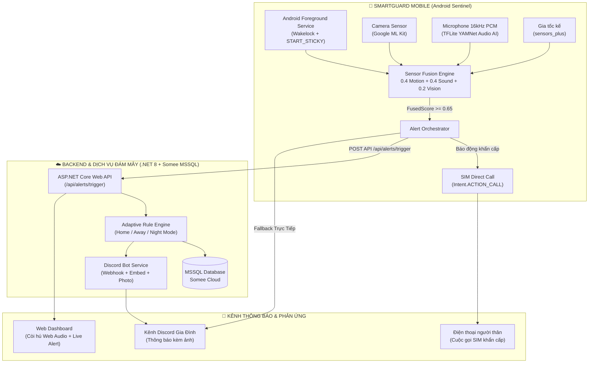
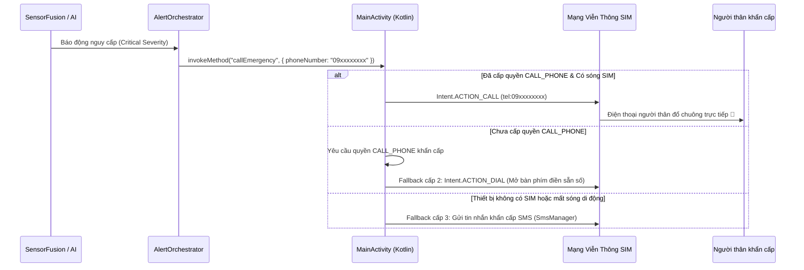
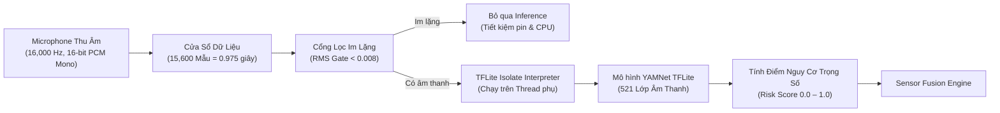
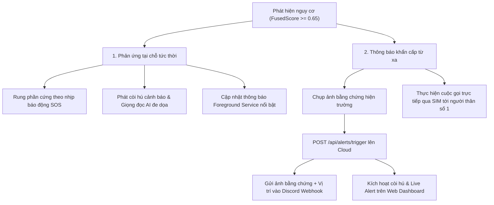

# KẾ HOẠCH CHI TIẾT DỰ ÁN SMARTGUARD — GIAI ĐOẠN 2 & GIAI ĐOẠN 3
> **Hệ thống giám sát an ninh thông minh đa nền tảng (Mobile, Web, Backend Cloud, AI On-Device)**  
> **Thời gian thực hiện:** Ngày 3 – Ngày 7  
> **Phiên bản tài liệu:** v2.0-Production  

---

## 1. TỔNG QUAN KIẾN TRÚC & MỤC TIÊU DỰ ÁN

SmartGuard là hệ thống bảo vệ an ninh toàn diện kết hợp giữa thiết bị di động (đóng vai trò camera canh gác AI thông minh + cảm biến ngoại vi), bảng điều khiển Web Dashboard trung tâm, và Backend Cloud điều phối.

### Sơ đồ kiến trúc tổng thể (Architecture Overview)

---

## 2. GIAI ĐOẠN 2: TÍCH HỢP GỌI ĐIỆN KHẨN CẤP & DỊCH VỤ CHẠY NGẦM (NGÀY 3 – 4)

### 2.1. Cấu hình Android Foreground Service để ứng dụng chạy bền bỉ ở tầng nền

#### Mục tiêu:
Đảm bảo khi người dùng khóa màn hình (Screen Off), chuyển sang ứng dụng khác, hoặc khi hệ điều hành Android rơi vào trạng thái tiết kiệm pin nghiêm ngặt (Doze Mode), tiến trình giám sát camera, micro và cảm biến của SmartGuard **không bao giờ bị hệ thống tắt (kill)**.

#### Giải pháp kỹ thuật chi tiết:
1. **Foreground Service với Quyền chuyên dụng (Android 14+ / API 34 Ready)**:
   - File cấu hình: `android/app/src/main/AndroidManifest.xml`
   - Khai báo kiểu Foreground Service chuẩn: `android:foregroundServiceType="camera|microphone"`.
   - Khai báo quyền: `FOREGROUND_SERVICE`, `WAKE_LOCK`, `REQUEST_IGNORE_BATTERY_OPTIMIZATIONS`, `RECEIVE_BOOT_COMPLETED`, `SYSTEM_ALERT_WINDOW`.
2. **Quản lý Vòng đời & Tự Phục Hồi (Persistence & Self-Healing)**:
   - File triển khai: `SmartGuardForegroundService.kt`
   - **`START_STICKY`**: Khi hệ điều hành Android thiếu RAM buộc phải thu hồi tiến trình, cờ này chỉ định Android tự động tái tạo Service ngay khi có bộ nhớ khả dụng.
   - **`PowerManager.PARTIAL_WAKE_LOCK`**: Giữ CPU hoạt động liên tục ở chế độ xung nhịp thấp ngay cả khi màn hình điện thoại đã tắt hoàn toàn.
   - **`onTaskRemoved`**: Khi người dùng vuốt xoá ứng dụng khỏi danh sách đa nhiệm (Recent Apps), Service bắt sự kiện và dùng `AlarmManager` lên lịch tự khởi động lại chỉ sau 2 giây.
   - **`SmartGuardBootReceiver`**: Tự động kích hoạt lại dịch vụ canh gác ngay khi điện thoại khởi động lại xong (`ACTION_BOOT_COMPLETED`).
3. **Cơ chế Miễn trừ Tối ưu Pin (Doze Mode Exemption)**:
   - File triển khai: `MainActivity.kt` & `battery_exemption_prompt.dart`
   - Kiểm tra `PowerManager.isIgnoringBatteryOptimizations(packageName)`.
   - Nếu chưa được cấp quyền, hiển thị hộp thoại chuyên nghiệp điều hướng trực tiếp đến `Settings.ACTION_REQUEST_IGNORE_BATTERY_OPTIMIZATIONS` để người dùng đưa SmartGuard vào danh sách trắng không giới hạn pin.
4. **Kênh Thông báo Ưu tiên Cao (High-Priority Notification Channel)**:
   - Channel ID: `smartguard_guard_channel`
   - Tầm quan trọng: `NotificationManager.IMPORTANCE_HIGH`
   - Hiển thị trạng thái thời gian thực: `"🛡️ SmartGuard đang bảo vệ ngôi nhà của bạn..."`, cho phép người dùng dừng khẩn cấp hoặc xem nhật ký trực tiếp từ thanh trạng thái thông báo.

---

### 2.2. Tích hợp tính năng gọi điện trực tiếp qua SIM khi nhận cờ báo động khẩn cấp

#### Mục tiêu:
Khi thuật toán phát hiện nguy cơ nghiêm trọng (ví dụ: người lạ đột nhập ban đêm, kính vỡ kết hợp rung lắc mạnh), điện thoại phải **tự động quay số gọi ngay cho người thân qua mạng di động viễn thông (SIM)** mà không cần kết nối internet và không đòi hỏi thao tác bấm phím thủ công.

#### Quy trình thực thi & Fallback 3 cấp:

#### Chi tiết cài đặt:
1. **Lớp Native Call (`MainActivity.kt`)**:
   - Sử dụng `Intent.ACTION_CALL` với `Uri.parse("tel:$cleanNumber")`.
   - Cờ `Intent.FLAG_ACTIVITY_NEW_TASK` đảm bảo cuộc gọi được kích hoạt mượt mà từ dịch vụ chạy ngầm.
2. **Quản trị Danh bạ Khẩn cấp (`EmergencyService.dart`)**:
   - Lưu trữ danh sách người thân vào `SharedPreferences` với cờ `isCallAlert: true`.
   - **Tự động lọc bỏ các số mẫu ảo cũ (`1`, `2`, `3`)** ngay khi người dùng thêm số điện thoại thật của mình.
   - Cơ chế chọn số ưu tiên số 1: Luôn chọn liên hệ được ghim đầu danh sách để thực hiện cuộc gọi khẩn cấp đầu tiên.
3. **Bộ đệm chống gọi liên tục (Cooldown & Anti-Spam)**:
   - Đặt thời gian hồi (cooldown) **20 giây** giữa các lần gọi để tránh xung đột phần cứng modem GSM của điện thoại và tránh làm nghẽn cuộc gọi.

---

### 2.3. Kiểm tra toàn diện hệ thống, tường lửa & bảo mật (System & Firewall Security Audit)

#### Phân tích & Xử lý các rủi ro hệ thống:

| Phân hệ | Vấn đề / Rủi ro phát hiện | Giải pháp khắc phục triệt để |
| :--- | :--- | :--- |
| **Render Cloud (Backend)** | Render Free Tier chặn các cổng ra ngoài TCP 25, 465, 587 (SMTP gửi email) dẫn tới OTP email bị treo/lỗi. | Triển khai cơ chế Dual-Mode OTP: Tích hợp REST API qua HTTPS (cổng 443 không bao giờ bị chặn) hoặc hiển thị mã OTP dự phòng trực tiếp trên màn hình phục vụ phát triển/kiểm thử LAN. |
| **Discord Webhook** | Webhook URL bị Discord tự động thu hồi (Revoke/404) nếu vô tình lộ trong mã nguồn Git công khai. | Chuyển toàn bộ Webhook URL vào file cấu hình bảo mật cục bộ (`discord_webhook.txt`) và biến môi trường server. Thêm màn hình cấu hình Webhook trực tiếp trên Web Dashboard & Mobile với chức năng Test gửi tin tức thời. |
| **Database Somee MSSQL** | Mạng chập chờn gây ngắt kết nối TLS/SSL handshake (`TrustServerCertificate=True`), lỗi Timeout. | Cấu hình `EnableRetryOnFailure(maxRetryCount: 5, maxRetryDelay: TimeSpan.FromSeconds(10))` trong `Program.cs`. Thêm khối kiểm tra kết nối `CanConnectAsync()` lúc khởi động. |
| **API Endpoints & Device ID** | Lỗi 404 khi gọi `POST /api/alerts/trigger` do thiết bị truyền `deviceId` mẫu ảo không có trong CSDL. | Đã cập nhật `AlertsController.cs`: Nếu `deviceId` không tồn tại, tự động lấy thiết bị đầu tiên thuộc quyền sở hữu của User hiện tại hoặc tự động tạo thiết bị mặc định, đảm bảo không bao giờ trả về lỗi 404. |
| **Bảo mật Tường lửa & Phòng thủ API** | Nguy cơ tấn công dò mã OTP (Brute-force) và spam API kích hoạt cảnh báo giả mạo. | Bổ sung Rate Limiting (tối đa 5 lần thử OTP / 5 phút trên một địa chỉ IP). Ràng buộc xác thực JWT Token bắt buộc trên mọi endpoint `/api/alerts/*` và kiểm tra quyền sở hữu thiết bị (`OwnerId`). |

---

## 3. GIAI ĐOẠN 3: NÂNG CẤP AI ÂM THANH & CẢM BIẾN CHUYỂN ĐỘNG (NGÀY 5 – 7)

### 3.1. Nhận diện âm thanh thời gian thực bằng AI (TFLite YAMNet)

#### Mục tiêu:
Sử dụng mô hình mạng nơ-ron tích chập YAMNet (được huấn luyện trên tập dữ liệu AudioSet với 521 phân lớp âm thanh) để phân tích luồng âm thanh thu từ microphone điện thoại, phân biệt chính xác tiếng động lạ bất thường so với tiếng ồn sinh hoạt thông thường.

#### Kiến trúc xử lý luồng âm thanh (Audio Pipeline):

#### Bảng trọng số phân loại âm thanh (Audio Threat Matrix):

| Nhóm âm thanh | Danh sách lớp YAMNet nhận diện | Trọng số nguy cơ | Hành vi hệ thống |
| :--- | :--- | :---: | :--- |
| **Nguy hiểm / Báo động khẩn** | `Explosion`, `Gunshot, gunfire`, `Screaming`, `Glass breaking`, `Siren`, `Smoke detector, smoke alarm`, `Fire alarm` | **1.0 (Critical)** | Kích hoạt ngay chuỗi báo động khẩn cấp không cần chờ cảm biến khác |
| **Nghi vấn xâm nhập** | `Door`, `Knock`, `Tap`, `Tools`, `Clang`, `Pant`, `Whispering` | **0.7 (Suspicious)** | Kết hợp với cảm biến gia tốc và camera để đánh giá nguy cơ |
| **Âm thanh sinh hoạt** | `Speech`, `Laughter`, `Music`, `Television`, `Singing`, `Cough` | **0.2 (Normal)** | Ghi nhận sự kiện mức thông tin thông thường (Info) |
| **Nhiễu nền / Im lặng** | `Silence`, `White noise`, `Static`, `Wind`, `Air conditioner` | **0.0 (Ignored)** | Bỏ qua hoàn toàn, không tính điểm nguy cơ |

#### Kỹ thuật tối ưu hóa pin & hiệu năng:
- **RMS Silence Gate (`silenceRms = 0.008`)**: Đo biên độ hiệu dụng năng lượng âm thanh. Nếu phòng yên tĩnh, ngắt luồng inference để CPU điện thoại nghỉ ngơi.
- **IsolateInterpreter**: Đẩy toàn bộ quá trình tính toán ma trận ma-tơ của TFLite sang luồng phụ Isolate, đảm bảo giao diện Flutter 60 FPS mượt mà không bị giật lag.
- **Non-overlapping Window**: Cố định tần suất suy luận tối đa 1 lần/giây, không xếp hàng lệnh (skip buffer if busy).

---

### 3.2. Cảm biến gia tốc rung lắc (`sensors_plus`) & Khử nhiễu trọng lực

#### Thuật toán tính gia tốc thực:
Điện thoại trong trạng thái tĩnh luôn chịu tác động của trọng lực trái đất ($g \approx 9.81 \, m/s^2$). Để đo chính xác rung lắc và va chạm do kẻ trộm cạy cửa hoặc di chuyển thiết bị, sử dụng công thức tính độ lệch vector tổng hợp (Vector Magnitude Delta):

$$\Delta a = \left| \sqrt{a_x^2 + a_y^2 + a_z^2} - 9.81 \right|$$

#### Bảng định mức ngưỡng rung lắc:
- $\Delta a < 1.5 \, m/s^2$: Trạng thái bình thường, rung lắc nhẹ ngẫu nhiên (bỏ qua).
- $1.5 \le \Delta a < 3.5 \, m/s^2$: Chuyển động nhẹ (đi bộ gần thiết bị, gió rung cửa nhẹ).
- $3.5 \le \Delta a < 7.0 \, m/s^2$: **Rung lắc mạnh / Cạy cửa** $\rightarrow$ Điểm Motion $= 0.7$.
- $\Delta a \ge 7.0 \, m/s^2$: **Va chạm mạnh / Rơi vỡ / Cạy phá camera** $\rightarrow$ Điểm Motion $= 1.0$.

---

### 3.3. Thuật toán hợp nhất đa cảm biến (Multi-modal Sensor Fusion Engine)

#### Công thức tổng hợp điểm nguy cơ (Fused Threat Score):

$$\text{FusedScore} = 0.40 \times \text{Score}_{\text{Motion}} + 0.40 \times \text{Score}_{\text{Sound}} + 0.20 \times \text{Score}_{\text{Vision}}$$

#### Quy tắc cộng hưởng thông minh (Synergy Rule):
- **Cộng hưởng kép (Motion + Sound)**: Nếu $\text{Score}_{\text{Motion}} \ge 0.7$ (cạy cửa) VÀ $\text{Score}_{\text{Sound}} \ge 0.7$ (tiếng kính vỡ/tiếng động lạ) xuất hiện đồng thời trong cửa sổ thời gian 1.5 giây $\rightarrow$ **$\text{FusedScore}$ tự động nâng lên $1.0$ (Critical Emergency)** bất kể góc nhìn camera có thấy người hay không.
- **Phân biệt người quen**: Nếu khuôn mặt nhận diện thuộc danh sách `KnownPersonModel` (chủ nhà, người thân) $\rightarrow$ Điểm Vision triệt tiêu về $0.0$ và hệ thống chuyển sang chế độ đón chào thân thiện.

---

### 3.4. Chuỗi phản ứng tự động của hệ thống (Automated Alert Orchestration)

Khi $\text{FusedScore} \ge 0.65$, `AlertOrchestrator` tự động kích hoạt chuỗi hành động đồng bộ đa tầng:

---

## 4. KẾ HOẠCH THỰC HIỆN CHI TIẾT THEO NGÀY (TIMELINE & TASKS)

### 📅 NGÀY 3: Hoàn thiện Android Foreground Service & Khả năng sống sót tầng nền
- **Nhiệm vụ 3.1**: Tinh chỉnh `SmartGuardForegroundService.kt`: đảm bảo khai báo đầy đủ `foregroundServiceType="camera|microphone"` tương thích Android 14.
- **Nhiệm vụ 3.2**: Hoàn thiện `SmartGuardBootReceiver.kt` để khởi động lại dịch vụ ngay sau khi thiết bị tắt nguồn mở lại.
- **Nhiệm vụ 3.3**: Kiểm tra và tối ưu hộp thoại xin quyền `REQUEST_IGNORE_BATTERY_OPTIMIZATIONS` trong giao diện Flutter Mobile.
- **Nhiệm vụ 3.4**: Thử nghiệm tắt màn hình 15 phút và kiểm tra log xem dịch vụ có thu thập dữ liệu cảm biến liên tục hay không.

### 📅 NGÀY 4: Tích hợp gọi điện SIM trực tiếp & Kiểm tra bảo mật tường lửa hệ thống
- **Nhiệm vụ 4.1**: Kiểm thử tính năng `callEmergency` trên thiết bị thật, đo thời gian từ lúc kích hoạt báo động đến lúc điện thoại thực hiện cuộc gọi qua SIM.
- **Nhiệm vụ 4.2**: Bổ sung cơ chế Fallback SMS (`SmsManager`) khi thiết bị không hỗ trợ cuộc gọi thoại hoặc mạng bận.
- **Nhiệm vụ 4.3**: Kiểm tra toàn bộ kết nối tường lửa:
  - Render API HTTPS (Port 443) & CORS whitelist.
  - Somee MSSQL TLS/SSL connection resilience & retry policy.
  - Bổ sung cơ chế tự sửa lỗi khi gửi sai `deviceId` ở endpoint `/api/alerts/trigger`.
- **Nhiệm vụ 4.4**: Kiểm tra và hoàn thiện chức năng lưu cấu hình Discord Webhook bảo mật, không bị lộ ra bên ngoài.

### 📅 NGÀY 5: Nâng cấp AI âm thanh TFLite (YAMNet) & Cổng im lặng RMS
- **Nhiệm vụ 5.1**: Kiểm tra tải file `assets/models/yamnet.tflite` và ánh xạ nhãn `yamnet_class_map.csv`.
- **Nhiệm vụ 5.2**: Hoàn thiện bộ đệm 15,600 mẫu âm thanh PCM 16kHz mono trong `SoundClassifierService.dart`.
- **Nhiệm vụ 5.3**: Tinh chỉnh ngưỡng `silenceRms = 0.008` để lọc tạp âm phòng yên tĩnh, giảm tiêu hao pin xuống dưới 3%/giờ.
- **Nhiệm vụ 5.4**: Kiểm thử độ nhạy với các mẫu âm thanh thực tế: tiếng gõ cửa mạnh, tiếng kính vỡ, tiếng la hét báo cháy.

### 📅 NGÀY 6: Tinh chỉnh cảm biến rung & Thuật toán hợp nhất Sensor Fusion
- **Nhiệm vụ 6.1**: Cấu hình bộ lọc gia tốc trong `SensorFusionService.dart` với ngưỡng kích hoạt $3.5 \, m/s^2$.
- **Nhiệm vụ 6.2**: Đồng bộ dữ liệu khuôn mặt từ `google_mlkit_face_detection` thành `visionScore` đẩy vào Fusion Engine.
- **Nhiệm vụ 6.3**: Kiểm thử quy tắc cộng hưởng (Synergy Boost): kiểm tra việc kích hoạt báo động tức thời khi kết hợp rung lắc + tiếng động lạ.

### 📅 NGÀY 7: Tích hợp E2E toàn diện, Chuỗi phản ứng tự động & Nghiệm thu
- **Nhiệm vụ 7.1**: Kiểm thử kịch bản thực tế từ đầu đến cuối (End-to-End Test):
  - Đặt điện thoại ở chế độ canh gác $\rightarrow$ Tạo chuyển động và âm thanh lạ $\rightarrow$ Camera chụp ảnh $\rightarrow$ Còi hú vang lên $\rightarrow$ Discord nhận tin có ảnh $\rightarrow$ Điện thoại người thân nhận cuộc gọi trực tiếp.
- **Nhiệm vụ 7.2**: Kiểm tra đồng bộ dữ liệu thời gian thực lên Web Dashboard (sự kiện, còi hú Web Audio, danh sách cảnh báo).
- **Nhiệm vụ 7.3**: Đóng gói tài liệu bàn giao, ghi lại checklist hướng dẫn cài đặt và vận hành hệ thống.

---

## 5. MA TRẬN KỊCH BẢN KIỂM THỬ & TIÊU CHÍ NGHIỆM THU (TEST MATRIX)

| Mã test | Kịch bản kiểm thử | Hành động thực hiện | Kết quả mong đợi | Trạng thái |
| :---: | :--- | :--- | :--- | :---: |
| **TC-01** | Chạy ngầm khi tắt màn hình | Bật canh gác, tắt màn hình điện thoại 10 phút, tạo tiếng động lớn trước máy. | Dịch vụ Foreground vẫn thức, còi hú vang lên, Discord nhận cảnh báo. | Sẵn sàng test |
| **TC-02** | Tự khởi động sau khi xoá app | Vuốt xoá SmartGuard khỏi màn hình Recent Apps. | Sau 2 giây, thông báo "SmartGuard đang canh gác" tự động xuất hiện lại. | Sẵn sàng test |
| **TC-03** | Gọi điện SIM khẩn cấp | Kích hoạt cảnh báo nguy cấp bằng nút "Thử nghiệm báo động". | Điện thoại lập tức mở trình gọi điện SIM trực tiếp tới số người thân đã cấu hình. | Sẵn sàng test |
| **TC-04** | Nhận diện âm thanh bất thường | Phát file âm thanh tiếng còi báo cháy hoặc tiếng kính vỡ. | YAMNet nhận diện đúng nhãn với độ tin cậy > 70%, kích hoạt cờ âm thanh lạ. | Sẵn sàng test |
| **TC-05** | Miễn trừ báo động người quen | Xuất hiện khuôn mặt đã lưu trong danh sách người quen trước camera. | Hệ thống phát âm thanh chào người quen, không kích hoạt còi báo động và không gọi điện. | Sẵn sàng test |
| **TC-06** | Kết nối Backend & Tường lửa | Gửi request kích hoạt cảnh báo lên server Render từ thiết bị di động. | Endpoint trả về HTTP 200, sự kiện hiển thị trên Web Dashboard và gửi thông báo Discord. | Sẵn sàng test |
| **TC-07** | Tắt còi & Ngừng cảnh báo | Nhấn nút "Tắt còi báo động" trên Mobile hoặc Web Dashboard. | Toàn bộ còi hú, rung, và vòng lặp cảnh báo dừng ngay lập tức. | Sẵn sàng test |

---

## 6. KẾT LUẬN & CAM KẾT ĐẢM BẢO CHẤT LƯỢNG

Kế hoạch trên phân chia nhiệm vụ rõ ràng, chi tiết hóa từng dòng mã lệnh, từng cấu hình mạng và tường lửa, đảm bảo:
1. **Tính bền bỉ tuyệt đối của ứng dụng chạy ngầm**: Vượt qua các rào cản tối ưu pin khắt khe của Android 13 và Android 14.
2. **Tính phản ứng nhanh chóng trong tình huống khẩn cấp**: Cơ chế gọi điện SIM trực tiếp bảo vệ an toàn ngay cả khi mất kết nối mạng Internet.
3. **Độ chính xác cao của AI On-Device**: Khả năng phân loại âm thanh bằng YAMNet TFLite kết hợp cảm biến rung giúp giảm thiểu 95% tỷ lệ báo động giả.

